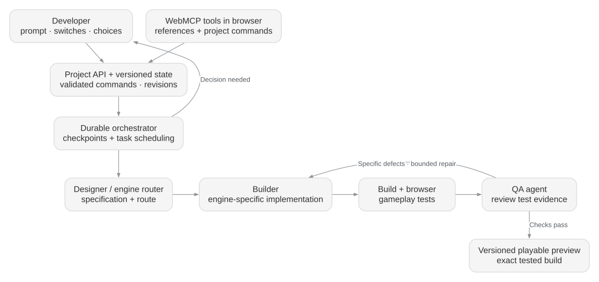
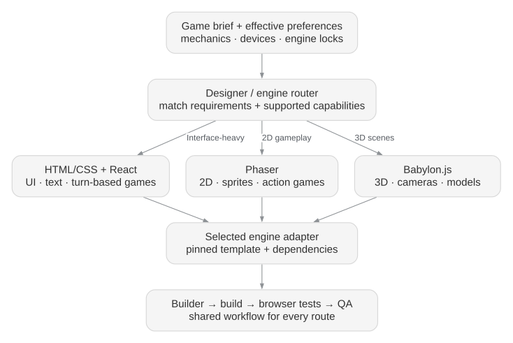
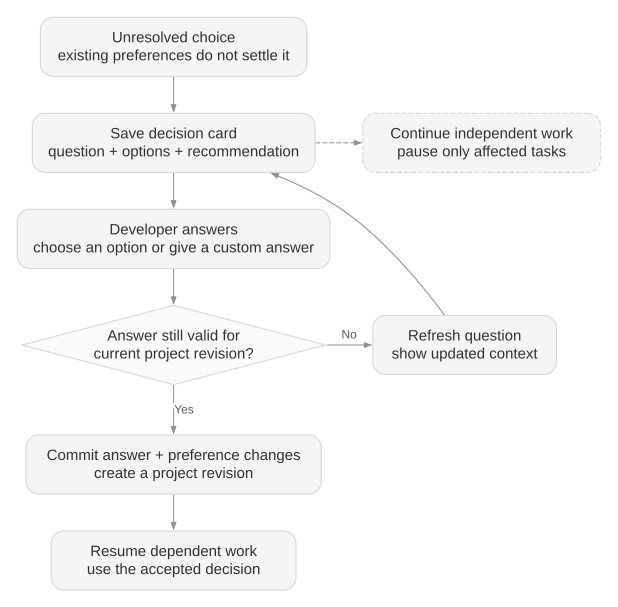

# Web Game Generator — Architecture diagrams

**WebMCP work:** [Research architecture, diagrams, and proposed material portal I/O contract](webmcp/README.md).

**Receiving the WebMCP work?** Read the [current-state handoff](webmcp/handoff.md) for delivered artifacts, ownership, interface expectations, and next steps. The research runtime and live portal integration are not implemented in this package yet.

Proposed multi-agent architecture for browser games, including mobile browsers.

[Editable Markdown / Mermaid](web-game-generator-mas-plan.md) · [Standalone HTML export](web-game-generator-mas-plan.html)

## 1. System architecture

[SVG](diagrams/system-architecture.svg) · [Editable DOT source](diagrams/system-architecture.dot)

## 2. Engine routing

[SVG](diagrams/engine-routing.svg) · [Editable DOT source](diagrams/engine-routing.dot)

## 3. Developer choices during generation

[SVG](diagrams/developer-decisions.svg) · [Editable DOT source](diagrams/developer-decisions.dot)

The HTML embeds all three diagrams and works offline. Download it to use the print / Save PDF controls. The Markdown contains editable Mermaid diagrams; the DOT files can be rendered with Graphviz.
