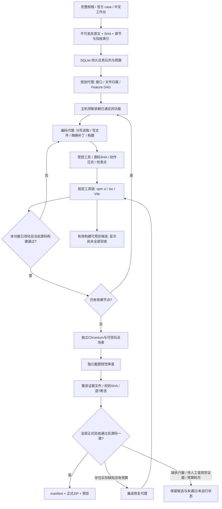

# Harness v2 运行架构

WebMCP 研究组件的独立状态机、接口和联合启动见 [组件接入说明](webmcp-integration.md)。harness 保留本文件描述的编排、工程构建、验收和交付职责；研究蓝图不会自动获得发布资格。

## 从完整规格到可验证工程

v2 处理有明确规则、数值、技术栈与验收项的长程游戏工程。完整原文最多 1,000,000 字符，保留字符区间、行号、分片和 SHA-256；已有正式规格直接进入工程规划，不经短摘要重写成简化游戏。Phaser / Babylon.js 引擎与 React + TypeScript + Vite 技术栈按规格锁定。



原 v1 单文件模式继续使用需求改写、RAG、设计、HTML 生成、浏览器与截图 QA 流程，支持 Canvas / DOM。它与 v2 共用控制面和模型适配器，但输入、工程执行方式、预算及交付门禁分别管理。

## 控制面与功能分工

`runner.Harness` 管理队列领取、任务取消、恢复、总时限和两条流程的分派。`project_runner.ProjectOrchestrator` 管理完整项目：归档规格、规划、检查依赖、依次执行功能、构建、独立验收及缺陷修复。模型提出动作，宿主代码决定是否执行及是否交付。

`ProjectLedger` 保存功能定义、owner、依赖、尝试、结果和源码修订。主机检查 DAG 无环、文件归属、验收项映射、完整规格章节覆盖，以及最终集成节点是否依赖各专项模块。功能可按配置、模拟、导航、战斗、技能、经济、音频、真实引擎场景和 React UI 分工。当前同一项目工作区使用文件锁串行集成；不同项目可并发，并不把一个工作区内同时写相同文件当成多智能体能力。

功能 `implemented` 只表示本功能已产出且当前源码构建有效；不表示对应玩法验收完成。整体验收还有独立报告。失败的功能与共享接口问题保留真实工具观察，可由有明确文件权限的协调修复回合处理；要求、owner 或文件归属发生变化时需要显式的新修订，不能静默复用原检查点。

SQLite 使用 rollback journal，适应当前单机 NFS 工作目录；进程锁避免同一数据目录启动第二个恢复服务。服务启动时恢复未完成任务及功能领取状态。当前不是跨主机分布式调度，不能用多个 uvicorn workers 共享此数据目录。

## 编码循环、上下文与恢复

编码代理使用结构化动作，而非一次生成整个项目：

| 工具 | 主机约束与返回证据 |
| --- | --- |
| `list_files`、`read_file` | 读取允许路径；记录源文件、范围、哈希和真实长度 |
| `read_context`、`read_observation` | 分页读取原文、接口、已归档工具观察；明确未读范围 |
| `write_file`、`apply_patch`、`delete_file` | 检查 feature 文件归属；补丁须唯一精确匹配；使用当前 SHA 前置条件 |
| `build` | 运行固定 TypeScript / Vite 工具链，返回真实退出码、日志、错误和产物清单 |
| `note` | 保存工作记忆；代理自述不作为验收证据 |
| `finish` | 需要有效源码变更及与当前源 SHA 一致的真实成功构建 |
| `blocked` | 记录无法完成的原因，不发布伪成功 |

长原文完整保存在磁盘，提示上下文只放当前功能相关章节、契约、有限近期观察及索引。已读区间由主机生成 `read_receipts`，包含原始长度和下一未读位置；重复读取的检测避免不断从头阅读而不产出。阅读缓存与短记忆帮助调度，不能替代原始规则或成为测试通过依据。

每个动作保存输入、提案、工具结果和检查点。文件变更先记录意图及前后 SHA，再执行写入；崩溃发生在写入与检查点之间时，恢复检测目标内容是否已经达到预期 SHA，避免补丁应用两次。当前文件与预备动作前置 SHA 不同则拒绝覆盖。源码、上下文或参考图变化会使旧构建或验收失效；恢复不会把旧的“已实现”标记直接当成当前版本已完成。

团队并行审查可在独立副本提出精确补丁。`reviewed_repairs.py` 只向已停止任务接入绑定批准 SHA 的补丁：核验完整工程基线、每步前后哈希及文件权限，持有工作区锁和短事务阻止恢复竞争，并先保存可重放日志。接入不修改功能完成状态、验收结论或调用预算；恢复后仍要执行真实构建与独立验证。已接入的提案在交接上下文中标记为 `already_applied`，避免再次应用旧补丁。

工具回合上限约束单个编码租约，不把大型功能强行压缩成一次输出。仅租约因 `action_limit` 或局部阅读停滞结束、且主机观察到源码 SHA 相对该租约开始时实质变化，才允许继续，最多 8 个租约；没有源码进展的故障仍最多 3 次尝试。每个租约保存起始 SHA 和轨迹，续接沿用原项目的全局预算，不通过重置调用、token 或时钟延长任务。

外部模型调用采用至少一次执行语义。进程异常后的重试可能重复发起已计费但尚未落盘的请求；不宣称供应商调用恰好一次。

## 真引擎工程运行时

`ProjectWorkspace` 初始化隔离的 run 目录，组合通用 React / TypeScript / Vite 配置与真实 Phaser 或 Babylon.js 模板。模板是引擎烟测起点，不能当成某个游戏的已实现版本。

模型仅可写 `src/**`、`public/**` 和 `index.html`，还受各 feature 的文件归属限制。绝对路径、父路径、隐藏路径、symlink 逃逸及不允许的文件类型被拒绝。包清单、锁文件、TypeScript 与 Vite 配置由主机模板控制；源文件导入另受工作区与固定依赖允许列表约束。补丁、文件数、文件大小与总源码大小均有边界。

构建直接执行可信的 `npm ci --ignore-scripts`、TypeScript 和 Vite 二进制，不执行模型提出的 shell 命令、安装命令、package script 或 Vite 插件。依赖固定到完整版本与锁文件完整性哈希；共享 npm 缓存可支持后续 `--offline` 安装。模板附有固定 `npm run build` / `dev` / `preview` 脚本供交付项目本地使用，但宿主编码工具仍调用固定命令。

构建返回阶段命令、退出码、耗时、stdout/stderr、源码 SHA、入口及每个 `dist/` 文件的 SHA。构建过程中源码变化或产物被篡改，不能沿用该构建。首次依赖下载与离线游戏运行是两回事：构建资源已本地打包、不使用 CDN，冷缓存仍需要包源。

## 独立验证与发布门禁

`project_validation.ProjectValidator` 只服务当前有效构建的 manifest 资源，用独立 Chromium 运行可信场景，而不读取编码代理自报的结果。验证覆盖三种屏幕尺寸、真实桌面/触屏操作、生命周期、方向切换、真实引擎上下文与绘制、资源清理，以及各 case 的数值边界与正常玩法轨迹。

统一 `window.__HARNESS__` 暴露生产 `Simulation` 的 `snapshot/config/dispatch/advance/events/isolatedSimulation`，以及真实引擎的 `engineInfo/projectEntity`。真实 UI、RAF 与测试推进使用同一套模拟逻辑；测试推进不能同时再跑第二套 RAF 更新。fixture 用于独立实例的初始边界条件，不能直接注入胜利、死亡、奖励或按测试 ID 返回预制结果。三关可赢必须另有从正常 `start` 出发、使用合法控制的完整轨迹；fixture 成功不能证明正常关卡可完成。

验证器检查实际引擎导入、WebGL / Canvas 创建与 draw 调用，点击测试使用真实相机投影与浏览器事件；模拟坐标变化不能冒充实际点击证据。内存、DOM/监听器和渲染资源观察与游戏自报计数分开。软件 WebGL 的无头桌面结果不能证明实体手机 60 FPS 或 Safari/微信兼容。

`project_review.review_visual` 单独接收主机截图、源 SHA、原始视觉准则与截图哈希；不以编码代理自述为依据。结果必须提供对应截图、具体元素位置、可见文字/外观和局限。缺少所需卡片、前后状态或指定视口时保持 `insufficient`。视觉模型可以判断可见布局或主题，不能替代机械数值、动作、动画时序、真人或实体设备性能测试。

`acceptance.evaluate_evidence` 再读取真实证据文件、核对 SHA 与来源绑定，并执行可信断言。报告区分 `passed`、`failed`、`not_run`、`manual_required`、`visual_required`；模型声明或缺少执行记录不能成为通过。仅构建成功、截图存在或 source 中出现某个常量均不足以代表完整玩法已验证。

正式交付同时要求：

1. 当前源码 TypeScript 与 Vite 构建成功；构建、浏览器报告和证据的源码 SHA 一致。
2. 证据绑定正确的原始规格 SHA；证据根目录与真实任务目录一致，引用文件及哈希可重新核验。
3. 全部原文正式验收 ID 均存在且逐项通过，不能遗漏或虚构编号。
4. 只有符合上述门禁才写正式 manifest、源码修订并将任务置为 `passed`。

真实失败推动集成修复；缺测试执行器、待人工或待视觉证据与代码缺陷分别记录，不通过盲目改游戏或放宽断言消除。预算或修复次数耗尽后保留候选和问题。

## 预算与运行产物

| 策略 | 默认值 | 配置 |
| --- | --- | --- |
| 完整项目模型调用 | 600 | `PROJECT_MAX_MODEL_CALLS` |
| 完整项目已报告 token | 6,000,000 | `PROJECT_MAX_TOTAL_TOKENS` |
| 完整项目总时限 | 21,600 秒（6 小时） | `PROJECT_TIMEOUT_SECONDS` |
| 单功能单租约工具回合 | 36 | `PROJECT_FEATURE_STEPS` |
| 有源码进展的功能租约上限 | 8 | 主机续接策略；仍受全局预算限制 |
| 无源码进展的故障尝试上限 | 3 | 主机恢复策略 |
| 整体验收修复轮数 | 8 | `PROJECT_REPAIR_ROUNDS` |
| 单文件模式 | 16 次 / 100,000 token / 1,200 秒 / 2 次修复 | `MAX_MODEL_CALLS` 等原配置 |

项目执行策略写入 `execution-policy.json`。调用与 usage 在主机持久记录，总时限从首次执行起计算并包含停机时间；resume 不清零预算。输入 token 估算是调度启发式，不是精确 tokenizer；供应商已报告 usage 超限会阻止后续交付，断网时未返回的计费不能凭空获知。

当前网关使用 `MODEL_REASONING_EFFORT=none`，模型仍为 `qwen3.8-max`。角色可独立覆盖，代码模型动作严格校验结构。文本、SSE、图片探针与完整游戏验收是不同证据范围。

```text
data/
  harness.sqlite3, server.lock
  npm-cache/
  diagnostics/model-probe.json
  runs/<id>/
    execution-policy.json
    specification.txt, specification.json
    implementation-plan.json, project-progress.json
    project-retrieval-<feature>.json    # query / 来源文档 / 警告
    project-lease-<feature>-<attempt>.json
    coding-<feature>-<hash>.context.json
    coding-<feature>-<hash>.step-0001.input.json
    coding-<feature>-<hash>.step-0001.action.json
    coding-<feature>-<hash>.step-0001.result.json
    coding-<feature>-<hash>.checkpoint.json
    independent-code-review.json       # 若有独立源码审查，属建议而非验收
    project/
      package.json, package-lock.json, tsconfig.json, vite.config.mjs
      src/, public/, dist/
      .harness/                       # 构建记录、日志及工具元数据
    project-build-0.json
    project-r0-*.json, project-r0-*.png
    project-evidence-0.json, project-validation.json
    project-visual-*.json
    project-delivery.zip               # 可为尚未验收的候选
    manifest.json                      # 正式发布门禁通过后
```

## 预览、存档与执行权限

有效候选构建可通过项目 candidate 接口预览，不要求提前把任务改成 `passed`。预览重新检查源 SHA 和资源哈希，将构建后的 JS/CSS/本地素材内联成可在 opaque srcdoc 运行的 HTML。候选显著标注尚未全部验收；候选 ZIP 与正式 ZIP 共用格式，正式性以任务状态、manifest 和逐项验收报告判断。

有效构建还会随 ZIP 交付内联资源的 `playable.html`，可离线双击运行；`delivery-manifest.json` 记录对应源与产物 SHA。该交付包装能力不改变候选状态，也不代表三个大型游戏已经通过。

工作台 iframe 始终使用 `sandbox="allow-scripts"`，不提供 `allow-same-origin`。CSP 与浏览器路由限制联网、子框架和危险资源。父页只读取 `game-save:<runId>` 中的 JSON，将当前 run 的字符串键值注入 iframe 内 localStorage facade；保存消息必须同时匹配 iframe 窗口、当前 run ID、字符串值和 1 MB 大小限制。其他任务存档、sessionStorage 口令及父页本地数据均不注入。

构建在与服务相同的部署用户下运行 Node/npm/TypeScript/Vite 子进程。传入的是最小环境，不转发模型 API 密钥、SSH agent、npm token 或用户 npmrc；安装禁用 lifecycle scripts，编译配置与命令不可由模型更改。Chromium 可启用自身 sandbox，测试上下文另有权限、下载、service worker 与请求限制。

**当前没有 OS 级容器或虚拟机边界。** 子进程仍具有部署用户的宿主文件与系统权限；路径检查和清空凭据只是应用层约束，不能承诺抵御编译工具或依赖的任意漏洞。当前是受控 210 环境的单机部署。多租户部署还需单独的受限构建/浏览器工作进程、网络命名空间、资源配额和外部状态存储，不应将现有文件锁称为完整计算隔离。

## 组件扩展与当前实测范围

`AgentClient` 是统一模型适配器。v2 每个功能按标题、游戏名和引擎调用已有 `Retriever`，将 query、文档 ID/来源和警告缓存为 `project-retrieval-<feature>.json`，通过 `retrieved_knowledge` 上下文章节供编码工具按需分页读取。检索数据不能覆盖原始规格、引擎锁或宿主指令，也不能作为省略已确定需求的理由。

`Retriever` 保留本地 BM25、外部 RAG 与素材门户 HTTP bridge；目前外部 RAG/门户真实地址尚未提供，不声称已连接真实服务。新增引擎需同时扩展可信模板、依赖锁、构建器与真实验收，不能只修改引擎枚举。

210 已实测两个引擎的锁定依赖安装、TypeScript / Vite 构建、真实渲染、无外部请求的 opaque iframe、热缓存全新工作区离线安装，以及真实 TypeScript 错误阻止 bundle。工作台另验证原小游戏预览、项目候选与正式状态区分、长 TXT 无损提交与下载、存档桥边界和移动布局。上述专项回归不代表三个大型游戏已经通过。

v2 的三个官方任务正在相同 run ID 下推进真实实现，详见 [团队接入状态](team-integration.md)。尚未完成的游戏数值、三关正常通关轨迹、视觉、音频及实体设备性能项必须保留实际状态。

### v1 打地鼠实测记录

真实生成回合 `b475570322d5409dadfc5549ceae0053`：中文 3×3 打地鼠，30 秒、10 分目标、触屏与数字键 1–9。全部角色使用 `qwen3.8-max`，6 次模型调用、45,346 个报告 token、222.921 秒、1 次自动修复，最终批准 v2。首个候选的状态机冒烟通过，但截图 QA 拒绝了横屏裁切；修复后的 v2 通过三尺寸浏览器与截图/代码 QA。最终 HTML SHA-256 为 `3bfda65e35a0d012a9478ed21ce68f173e5e73fbd9b46765e15bd2940487c198`。

工作台内使用真实键盘事件获得 10 分并等待正常倒计时进入 `won`；胜利后重开、暂停/继续，再以零分等到 `lost` 并从失败重开，未写入游戏测试状态。证据位于同一任务目录的 `gameplay-verification.json`、复验脚本、`workbench-preview.png`、`gameplay-won.png` 与 `gameplay-lost.png`。该证据仅覆盖这个小型游戏，不能替代三个大型官方 case。
