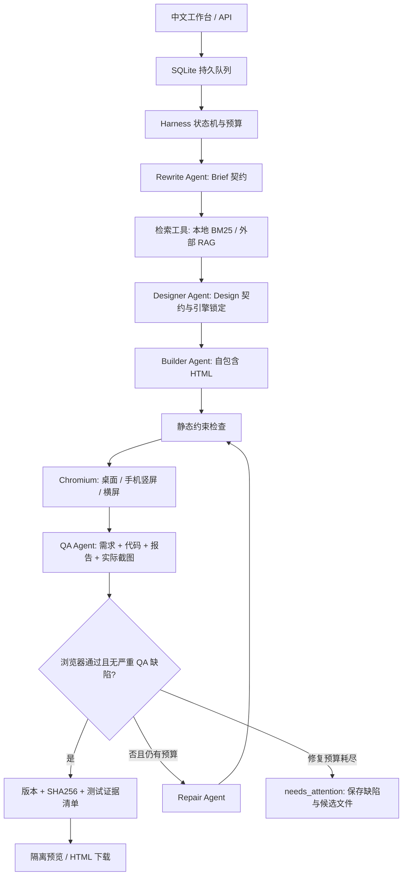

# Harness 运行架构

## 产品目标与边界

输入中文游戏描述，交付与用户明确要求一致、能离线打开的 HTML 游戏，以及可追踪的需求、设计、代码版本、实测记录和 QA 结论。运行时不执行模型生成的 shell、Python 或安装命令，只在 Chromium 中运行生成的前端代码。



## 控制面：代码掌握流程与权限

所有任务使用有界流程。模型负责提出结构化需求、设计、实现与缺陷；状态转换、检索、文件保存、实际测试和发布由 harness 决定。QA 的 `pass` 不能覆盖浏览器失败，也不能覆盖 `critical/major` 缺陷。

SQLite 保存状态、调用次数、已报告 token 和事件。产物写入临时文件、fsync 后原子重命名。项目部署于 NFS，因此使用 rollback journal，不依赖 WAL 共享内存；仅单台 210、单服务进程使用该数据目录，进程文件锁防止第二个服务同时恢复同一队列。更大规模或多主机部署应替换为 PostgreSQL 和独立任务队列。

启动时把未完成的 `running` 任务重新排队。每个结构化阶段保存输入指纹和输出哈希；完成记录在结果落盘后单独原子写入，输入轨迹不代表阶段已完成。输入、模型、指令、截图或输出内容变更时不会复用旧结果。候选版本、实测报告、QA 与截图都按版本保存。进程异常可能导致正在进行的模型调用重新发起，已经完成的检查点会被复用。系统保证至少一次执行，不声称外部模型调用恰好一次。

用户取消立即持久化并取消对应异步任务；关闭服务保留 running 供恢复。失败任务可以手动 resume，已有的调用、token 和从首次启动计算的总时限继续生效。达到修复上限进入 `needs_attention`，不会发布待修复代码。

## 数据契约与运行产物

Pydantic 严格校验 `Brief`、`Design` 和 `Review`。多余字段被拒绝；结构化输出失败可纠正一次。HTTP 连接错误和部分 4xx/5xx 可退避重试，单调用最多三次，所有请求均计入持久化调用预算。模型返回截断或空内容时失败，不把半份代码视作可交付。

Builder / Repair 默认使用流式响应，每 5 秒记录一次生成进度；收到结束标记后才交付候选代码。`STREAM_BUILD=false` 可适配没有 SSE 的服务。单次网络请求默认超时 300 秒，浏览器候选测试默认超时 60 秒，总任务时限仍独立生效。

默认最多 16 次模型请求、100000 个已报告 token、2 次修复和 1200 秒总任务时限。发起请求前用保守的输入估算和输出上限检查剩余 token；供应商 tokenizer 与图片计费可能不同，真实 usage 超过预算会立即停止后续阶段。网络中断时供应商实际计费可能无法获知，calls 仍被计数。角色和模型名在事件中记录。

```text
data/
  harness.sqlite3
  server.lock
  diagnostics/model-probe.json
  runs/<id>/
    brief.input.json, brief.json, brief.checkpoint.json
    retrieval.json
    design.input.json, design.json
    call-01-rewrite.txt, ...
    v1.build-input.json, v1.html
    v1.report.json
    v1-desktop.png, v1-portrait.png, v1-landscape.png
    v1.review.input.json, v1.review.json
    v2.*                         # 发生修复时
    manifest.json                # 双重门禁通过后才有
```

## 游戏适配器契约

目前 Canvas 与 DOM 两种离线原生实现共用以下协议。引擎路由会验证用户的锁定选项；不会选择未安装的第三方引擎。

| 接口 | 规则 |
| --- | --- |
| 主区域 | `[data-testid="game-root"]` |
| 分数 | `[data-testid="score"]` |
| 生命周期按钮 | `[data-action="start/pause/resume/restart"]`，分别独立元素 |
| 手机输入 | 至少一个可见的其他 `data-action` 控件 |
| 状态观测 | `window.__GAME__` 实时暴露 `{state, score, ticks}` |
| 状态枚举 | `ready/running/paused/won/lost` |
| 计时 | running 时 ticks 递增，暂停时冻结 |
| 重新开始 | 回到 running，score/ticks 归零，清理旧状态 |

测试执行页面加载 → 开始 → 观察 ticks → 暂停与冻结 → 继续 → 键盘/触屏 → 重新开始与得分归零。对每个尺寸创建新浏览器上下文。当前操作冒烟只确认输入事件可发送且运行无报错，未证明每一个输入都产生正确游戏效果；游戏特定胜负与复杂数值规则目前靠代码 QA 和人工复验，后续需接入相应玩法适配器。

## 工具接入点

| 模块 | 当前实现 | 替换方式 |
| --- | --- | --- |
| `agents.AgentClient` | OpenAI 兼容 Chat Completions / 图片内容 | 保持 complete 与 structured 协议；按 role 接入已有 agent |
| `rag.Retriever.search` | 中英分词 BM25 与 HTTP 外部适配 | 返回 query/documents/warnings；保留 id/source 引用 |
| `schemas.Design` | canvas/dom 枚举与具体规则 | 新引擎需同时补模板、离线依赖、构建器、测试与允许列表 |
| `validation.BrowserValidator.validate` | 静态检查和 Chromium 三尺寸冒烟 | 返回 passed/sha256/viewports；可增加游戏特定测试或浏览器 |
| `runner.Harness` | 有界状态机和检查点 | 保留发布门禁、预算与输入指纹，增加参考图、素材或评估阶段 |

检索文档均按数据处理，不能改变系统指令。外部 RAG 失败回退本地并在事件中说明，不伪造“已接入团队知识库”。本地知识是随代码维护的启发式内容，不是外部文献的已验证结论。

## 预览、执行与部署约束

静态检查排除外部脚本、资源和危险容器等常见问题。Chromium 启用进程 sandbox；页面 CSP 禁止联网、外部脚本、子框架和 worker。测试拦截并阻断其他资源请求；每个上下文禁用权限、下载与 service worker。页面上只在 sandbox iframe 中预览，保留相同 CSP。预览请求重新核对 manifest 中的 SHA256；HTML 产物接口始终按附件返回。

这套措施不等同完整多租户 OS 沙箱。面向不可信公网用户时，应把浏览器测试迁入独立、无凭据、受资源限制且无内网访问权限的容器服务，并设置 API 身份与额度管理。默认启动脚本只绑定 loopback，当前 hackathon 部署的开放监听仅供受控内网使用。

未实现：原型 URL/视频抓取、人工决策卡、外部素材下载、向量 embedding、Phaser/Babylon 模板、分布式任务队列、游戏特定端到端验收和 Safari/微信真机测试。这些都不作为首版已完成能力展示。
