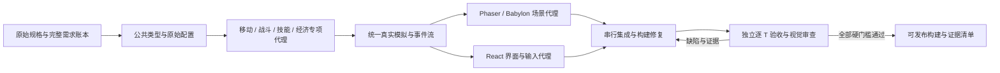

# 长程游戏工程 Harness：来源、取舍与运行契约

调研日期：2026-10-16（美国太平洋时间）。下列 commit 是本次读取源码的固定快照，不是随 `main` 漂移的依赖。本文借鉴工作机制，当前实现没有复制这些项目的源码，也没有把研究文章中的效果当成本项目的验证结果。

三个大型 case 是产品的必做验收集。长规格、多文件、Phaser/Babylon 和长时间任务应由 harness 承担，不能把输入截断成小玩法，或把基础冒烟成功写成原始 case 通过。

## 一手来源与选择

| 来源与固定版本 | 核实的机制 | 本项目的采用方式 |
| --- | --- | --- |
| [Anthropic: Effective harnesses for long-running agents](https://www.anthropic.com/engineering/effective-harnesses-for-long-running-agents)，2025-11-26 | 初始化与后续编码会话职责分离；持久化 feature 清单；每次增量实现；交接记录；用浏览器验证完成条件。 | 初始化工程、无损规格索引和验收台账；按 feature 执行；代码、观察、进度独立落盘；最终交付由验收 gate 决定。 |
| [mini-swe-agent `04d809c`](https://github.com/SWE-agent/mini-swe-agent/blob/04d809ceab9df28f9adaed044884180159172930/src/minisweagent/agents/default.py)；[SWE-agent `3ea751c`](https://github.com/SWE-agent/SWE-agent/tree/3ea751c087f32b16e039a2233dd6eefecef325d5) | mini 的模型→动作→环境观察循环短而清楚；有步数、成本、时间限制，并持久化 trajectory。SWE-agent 提供更广的工具和历史处理选项。 | 保留可审计的小循环与预算；将环境动作限制为项目文件操作、精确补丁和固定构建入口，而非开放任意 shell。一次只交一个完整动作，模型格式错误、输出截断均不能被视为成功。 |
| [OpenHands 软件代理 SDK `1fbfd37`](https://github.com/OpenHands/software-agent-sdk/tree/1fbfd37f6fb21491ed733fc92d409aff1517ff4a)，[Conversation](https://github.com/OpenHands/software-agent-sdk/blob/1fbfd37f6fb21491ed733fc92d409aff1517ff4a/openhands-sdk/openhands/sdk/conversation/conversation.py)，[Condenser 设计](https://github.com/OpenHands/software-agent-sdk/blob/1fbfd37f6fb21491ed733fc92d409aff1517ff4a/openhands-sdk/openhands/sdk/context/condenser/README.md) | Conversation 区分本地/远程工作区；完整事件记录与发给模型的压缩视图分离；保留近期事件、压缩早期事件。 | 210 是执行工作区；每轮输入、动作和完整观察分别归档；模型只拿 feature 包、工作摘要和近期观察，原始内容按引用分页读取。 |
| [LangGraph `41c9c22`](https://github.com/langchain-ai/langgraph/tree/41c9c22fdc83d68a2859d0c9a2b627c8615a792f)，[持久化文档](https://docs.langchain.com/oss/python/langgraph/persistence) | 线程状态通过 checkpointer 持久化；可恢复状态和跨线程长期存储是不同层。 | 每个 run/feature 有独立恢复检查点；不可变规格和证据不压进对话；动作先记录意图再执行。恢复不能假定外部副作用天然只执行一次。 |
| [Deep Agents `2540af1`](https://github.com/langchain-ai/deepagents/tree/2540af1ecfc61452b2695bcda032db61279ce1bd)，[压缩中间件](https://github.com/langchain-ai/deepagents/blob/2540af1ecfc61452b2695bcda032db61279ce1bd/libs/deepagents/deepagents/middleware/summarization.py)，[子代理中间件](https://github.com/langchain-ai/deepagents/blob/2540af1ecfc61452b2695bcda032db61279ce1bd/libs/deepagents/deepagents/middleware/subagents.py) | 子代理有明确任务接口和上下文边界；较长历史被转存，保留可检索指针；摘要是当前工作视图。 | 专项 role 分别承担数据、机制、模拟、渲染、UI 和审查；按依赖派发；上下文是相关规格片段与公共接口，避免每轮重复整本规格。 |

这里选择复用模式而非直接引入上述整个运行栈：现有系统已经拥有兼容 Qwen 网关的计量客户端、SQLite 队列、NFS 持久化与真实浏览器验证。现在需要保持这些行为和运行记录连续，并补齐工程工作区、增量工具循环及严格的项目验收。替换为某一框架仍然需要自行编写这些游戏引擎、规格和证据适配器。轻量的明确协议便于在 hackathon 中定位一次动作失败的实际原因；后续若需要分布式 worker，可在相同状态/工具契约上接入 LangGraph 或 OpenHands，不必更换原始规格与验收账本。

## 从“生成一份 HTML”到工程任务

输入层保存原始 TXT、参考图片、字节 SHA 和带行号的完整分块。计划层建立需求→feature→正式 T 用例的关联。检索和压缩只影响当次上下文视图，不能改变需求来源或删去难项。若模型没有读到完整片段，预览必须显式标记 `truncated`，允许继续分页读取。

工程层固定 React、TypeScript、Vite 和指定引擎的可复现模板。模型可写 `src/**`、`public/**` 与 `index.html`；构建配置、锁文件、依赖清单、规格和验收实现由主机维护。每个 feature 的输入需要写清公共接口、依赖、产出文件及 `owned_paths`。建议的依赖结构是：



专项代理可以使用同一个模型，但必须是真实独立调用、独立上下文、明确 owner 和可追溯输出。并发写同一目录不是多代理能力。当前 `CodingAgent` 对整个 workspace 持有进程锁，实施串行集成；独立 workspace 可以并行执行。未来启用 git worktree 时仍须执行补丁合并、依赖接口检查和集成后的重新构建。

## CodingAgent 的实际执行契约

```python
agent = CodingAgent(client, store, workspace,
                    max_steps=36, context_chars=28_000)
result = await agent.run_feature(
    rid,
    feature={"id": "combat-v1", "objective": "真实伤害与目标选择",
             "owned_paths": ["src/simulation/combat.ts"]},
    context={"project_summary": summary, "interfaces": contracts,
             "spec_excerpts": relevant_chunks, "review_feedback": defects},
    role="build", owner="combat-agent",
)
```

一轮只允许一个结构化动作：列文件、分页读文件、分页读上下文/历史观察、写文件、精确 patch、按当前 SHA 删除自己负责的文件、构建、记录交接、请求完成或报告阻塞。动作来自现有 Chat Completions 客户端，使用严格 JSON schema；不依赖模型供应商的专有工具协议。主机对路径、所有权、精确匹配和源文件 SHA 再做校验。

状态文件记录 feature 指纹、owner、role、workspace、步数、改动文件、当前源文件 manifest、最近构建、短期 memory 与 pending 动作。完整动作和观察单独存储。每个动作执行前先把意图及修改前/后的 SHA 落盘，执行后再提交观察与检查点。恢复时：文件已是预期结果则记为已应用；文件仍是原值则继续执行；文件被其他作者改变则拒绝覆写，向代理返回冲突。构建、读取等可安全重做的动作按需重跑。

替换现有文件前必须先完整读到当前版本；大文件用只匹配一次的精确 patch，防止把没看见的后半文件丢掉。构建失败以真实错误回到下一轮，不通过删测试、关闭类型检查、改依赖或改验收定义规避。模型输出截断、网关故障和预算耗尽保留恢复状态并明确失败，不能产生成功结果。

上下文采用“持久化原件＋有界工作视图”：每个 feature 是新会话；默认活动包不超过 28,000 字符，包含相关规格预览、接口、owner、文件 manifest、交接 memory 和近期观察。全文上下文和观察有分页取回工具。字符上限只是确定性的控制面上限，调用准入仍由 token 估算及 provider 实际用量共同计量。

项目调度采用 32,000 字符活动包与最近 3 个观察；读取工具实际每页最多 6,000 字符，并按 JSON 编码后的真实长度进一步收缩。读取结果的 `characters`、`offset`、`next_offset` 和源 SHA 始终位于顶层；裁剪仅影响内容预览，不能用预览本身的长度代替原文长度。主机另外持久化 `read_receipts`：已读源区间、真实总长度、最近续读位置与源 SHA。相同源位置第 2 次无进展读取会收到续读提醒，第 5 次停止当前会话并反馈 `needs_work`。新的阅读区间或实际代码修改会重置无进展计数。

运行行为与数据配置按实际路径区分：`src/game/skills/` 和 `src/game/enemies/` 是运行模块目录，不能因为名称含 skills/enemies 就当成配置阶段。配置文件拥有者优先拿完整配置；运行模块拥有者持续携带当前真实共享类型与精确导出接口。回归通过实际结构化模型输入检查三类 owner 均收到同一 SHA 绑定的完整 types，避免接口猜测和反复读取。

这些约束来自真实长程执行中遇到的失败：把整个工具结果封装成截断 JSON 字符串，会把页尾偏移元数据藏掉，导致代理反复读取同一页；按未转义的字符串长度预算，也会在代码含大量引号和反斜杠时超出活动包。回归测试同时覆盖 8k/60k 编码边界，以及从原文偏移 17,400 读取后依真实 `next_offset` 继续、随后开始写代码的完整路径。恢复不能只保存一段“还需要读更多”的模型 memory。

长程项目和小 HTML 任务使用独立预算配置。当前项目配置上限为 600 次调用、600 万实际报告 token 与 6 小时；每段编码会话最多 36 个动作。主机观察到本租约源码 SHA 实际改变，且停止原因为 `action_limit` 或局部阅读停滞 `non_progress` 时，可续租最多 8 段；整个租约无源码进展和其他失败至多 3 个 attempt，并可派发有明确权限与记录的 16 步集成修复会话。交接包含模型 memory、主机阅读记录和下一待写文件，避免一次会话不足就永久停止复杂 feature。仅模型自述“有进展”不授予续租。上限不表示预计消费量。provider 实际用量持续计入同一 run；重启、恢复、重新派发都不清零。预算配置变更应有事件记录；达到限制保留工作区与失败原因，而不伪造完成。

工程调度可以给视觉/场景 feature 注入完整参考图。`CodingAgent(..., images=[...])` 在首次动作把图像发给模型；之后只保留文件名和内容 SHA，恢复也按 SHA 避免重复灌图。参考图内容改变时重新检查。`read_context(section="__specification__", offset=..., limit=...)` 可取回主机固定存档的完整原文；这条入口与 feature 的相关章节预览同时存在，避免分工后只留下不可读取的文件名。

## 完成状态与证据的权限

`finish` 是申请，不是模型自行批准。主机必须确认最新 source manifest 的真实 typecheck/build 成功，且存在入口与产物 manifest，才返回 `implemented`。这只说明该 feature 达到了构建条件，默认 acceptance 仍为 `not_run`。可注入主机验收 verifier；失败的 verifier 会被送回代理继续修复，缺少检查证据不能通过。

原始 case 的通过条件应同时包含：所有必做需求有实现与来源映射、正式 T 的真实行为证据、正常玩家输入可达的成功/失败路径、指定引擎确实渲染、桌面和手机截图及独立视觉审查、无异常循环/资源泄漏。只读配置检查、静态代码搜索、模型自评、冒烟截图均不能独立代替这些条件。没有执行的 T 保持 `not_run`；缺失硬项保持失败，即使 build 成功也不发布。

`window.__HARNESS__` 应观察同一生产 simulation：`snapshot` 读真实状态，`dispatch` 执行真实用户动作，`advance` 使用同一固定步进更新函数，`events` 输出实际规则事件。测试模式只冻结 rAF 驱动并固定 PRNG，不注入胜利、不直接加血/加战力、不跳过技能/敌人规则。验收器维护输入与前后状态 trace，代理不能修改验收器或验收结果。

## 独立视觉审查与真实设备边界

`project_review.review_visual` 使用独立 QA 调用，只输入原始视觉准则和主机捕获的截图。它不读取编码代理的“已完成”自述。截图必须是本 run 下真实存在、SHA 可验证且尺寸一致的 PNG，并与当前 project/spec SHA 绑定。每次最多审查 3 项准则、输出最多 4k token，避免一次冗长审查被截断。

有效结论需要至少两个具体事实，每个事实指明截图、元素、归一化位置框、实际文字或外观。主题、版式和可读性属于允许的视觉白名单；升级卡、终极进化反馈、战力颜色变化还必须有对应真实场景截图。只写“布局合理、符合要求”或当前画面看不到目标元素时，不生成通过证据。模型的 pass 是待验证结果：主机重算 prompt identity SHA，验证 model/role、图片 SHA、来源绑定、事实位置、视口和场景。完整输入、原始结构化输出、审查结果与图片引用都保留为证据。

证据生产者明确标记为 `vision_reviewer`，不冒充 `human`。布局/动态标签等混合准则仍必须同时有真实 browser/runtime 证据；视觉结果不能代替数值、操作或物理测试。原文要求真实手机流畅度的项目继续保持 `manual_required`，需要设备型号、浏览器版本和真实观测。桌面模拟视口、静态图片、模型自评都不能证明真机帧率。

交付 ZIP 必须携带报告引用的实际 trace、截图、构建报告与 SHA，而非只有索引文件；解包后应能复核同一构建的证据。执行环境的 `.env`、隐藏元数据、依赖缓存和进程日志不属于交付项目。

## 测试边界

`tests/test_coding_agent.py` 用真实 AgentClient + MockTransport 验证结构化兼容和计量，并验证精确补丁、错误反馈、崩溃后幂等恢复、外部修改保护、长规格分页、无进展读取防护、文件所有权、独立 verifier 拒绝、步数预算恢复与同时写入排斥。`tests/test_project_runner.py` 验证原文/计划范围、功能依赖恢复、预算隔离、并发项目隔离、证据重算和交付归档；正向发布控制使用单独小型自定义规格和真实 subprocess 观察，不作为正式 case 证据。`tests/test_project_review.py` 的模型输出是 mock，用于检验视觉证据契约、泛泛输出拒绝及机械/人工边界，不能证明模型实际看对了游戏。

这些测试验证控制面，不能证明三个游戏内容已经实现。引擎真实编译、实际浏览器行为、正式 T、正常三关通关以及视觉质量，必须由对应项目运行产生独立报告；没有执行的正式 T 继续保持未完成状态。
