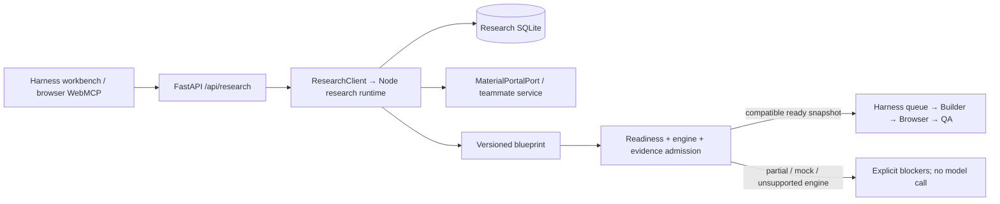

# Harness 与 WebMCP 联合运行

本次最终对齐 `codex/game-harness@bb451eb` 与 `Webmcp@82862cf`。Python harness 保留生成队列、模型预算、Builder、Chromium、QA 和发布门禁；Node WebMCP runtime 保留研究任务、修订、默认决策、玩法拆分和两套三轮讨论账本。harness v2 已提供 Phaser/Babylon 多文件项目流水线；本次不改写该实现，研究蓝图的自动接收钩子目前只接入 v1 单文件入口。

**交付范围：WebMCP 是 harness 内的研究组件。** 本次工作放在独立的 `codex/webmcp-harness-integration` 分支，供 harness 负责人审阅；不直接更新 `codex/game-harness` 或部署服务。harness 侧改动限于接入适配、固定版本蓝图传递、工作台入口，以及本机集成验证所需的 Windows/UTF-8 兼容修复。Builder、浏览器测试器、QA 和发布决策继续由 harness 维护；素材门户实现继续属于门户负责人。



## 启动

在完整仓库根目录准备 Python 环境，安装 harness 与 Node 依赖：

```sh
python -m venv .venv
# Linux: .venv/bin/python；Windows: .venv/Scripts/python.exe
.venv/bin/python -m pip install -e '.[test]'
cd webmcp
pnpm install --frozen-lockfile
cd ..
.venv/bin/python scripts/run_integrated.py
```

Windows 的联合启动命令：

```powershell
.venv/Scripts/python.exe scripts/run_integrated.py
```

Windows 联合启动用于研究组件与 v1 的接入验证。上游 v2 工程构建/编码使用 POSIX 文件锁和进程管理，完整项目执行仍需其支持的 Linux/macOS 环境；本次没有移植或代替项目运行时。

需要 Node.js `>=24.10 <25`。脚本在 loopback 启动 Python `18080` 与 Node `4174`，生成仅在两个服务内存中共享的 backend token，退出时停止它启动的 Node 子进程。可用 `--port 18081 --research-port 4175` 改端口。已有独立 studio 占用端口时选择另一个 research port。研究运行不调用模型；生成游戏仍需配置 `OPENAI_API_KEY`，浏览器验收需 `.venv/bin/python -m playwright install chromium`。

打开 [harness](http://127.0.0.1:18080)，点击“研究 MAS · 决策与蓝图”，或直接访问 [研究工作台](http://127.0.0.1:18080/research)。`HARNESS_API_TOKEN` 如果已配置，在主工作台“访问设置”中输入；研究工作台复用同一 sessionStorage 口令。浏览器不会接触 backend research token。原有独立 `pnpm start` 入口仍可使用。

若分别启动两端：Node 配置 `WEBMCP_TOKEN`，Python 配置相同的 `WEBMCP_RESEARCH_TOKEN`（至少 16 字符）和 `WEBMCP_RESEARCH_URL=http://127.0.0.1:4174`。URL 必须是 origin，不带路径、查询、用户名或密码。backend token 与面向用户的 `HARNESS_API_TOKEN` 是两个不同边界。

**数据路径：** harness 继续使用 `DATA_DIR` 与 rollback journal；Node 使用 `WEBMCP_DB` 与 WAL。Node 的数据库必须位于单台机器的本地磁盘，不能直接放在 210 的 NFS checkout 上。NFS 部署应设置例如 `WEBMCP_DB=/var/lib/webmcp/research.sqlite`，并自行准备该本地目录权限。此集成不自动启动远程服务或部署到 210。

## 接口与责任

| 入口 | 行为 |
| --- | --- |
| `/research` | 复用 `webmcp/public` 的研究 studio，API 前缀改为 `/api/research` |
| `/api/research/config` | 是否已配置、两套讨论上限、v1 交接目标与引擎、`project_handoff_supported: false`；不暴露 backend token |
| `/api/research/cases`, `/contract`, `/runs` | 转发到 Node 的对应 `/api/*` |
| `/api/research/runs/:id` | 状态、默认来源、问题、候选、账本与历史 |
| `POST …/follow-ups`, `…/material-follow-ups`, `…/cancel` | 原样转发；修订、requestId、父请求和额度由 Node 校验 |
| `GET …/blueprint` | 当前修订的蓝图；旧修订返回 `NOT_READY` |
| `POST …/handoff` | 以 `{runId, projectRevision, blueprintVersion}` 获取单个原子状态快照并检查 Builder 准入；不启动生成 |
| `POST /api/runs` | v1 可附相同 `research` 引用；不满足准入返回 409，不入生成队列、不调用模型 |
| `POST /api/projects` | 上游 v2 入口保持原有完整规格契约，尚未接收 `research` 引用 |

网关不重试写操作、不截断或重写研究输入、不把 `needs_clarification` 变成虚构答案。重试使用相同 requestId，由 Node 幂等处理。Node 不可用返回明确 503/504；不会替换成另一份 mock 成功结果。三轮限制和取消均继续由原 runtime 执行。

主工作台和研究工作台都复用 `webmcp/public/webmcp.mjs` 注册七个浏览器工具，新增 `resolve_research_proposal` 处理第一轮提案选择。普通浏览器没有原生 WebMCP 时，页面/API 仍可操作。静态资源公开，所有 `/api/research/*` 路由复用 harness 的鉴权依赖。完整仓库运行是当前部署要求；单独 Python wheel 不包含 Node runtime。

## 稀疏创意与默认补全

普通入口不再要求 `caseId`。使用 `mode: idea`，提供 `brief`、`knownFeatures`、`images` 中至少一项即可。图片继续使用门户可访问的 URI 或双方约定的资源引用，不传本机路径；网页尚未提供文件上传。`decisionMode: ask`（默认）在原型查询后进入 `waiting_input / decisions`；`auto` 自动采用默认方案并研究机制。关键词只用于推荐，不能当作已理解任意文字约束或图片内容。

```json
{
  "requestId": "idea-start-1",
  "projectId": "cat-game-1",
  "mode": "idea",
  "brief": "猫咪躲避敌人、越打越强的小游戏",
  "knownFeatures": ["猫咪主角"],
  "decisionMode": "ask"
}
```

读取任务中的 `decisionBatch`，再向 `POST /api/research/runs/:id/decisions` 提交 `requestId`、`expectedProjectRevision`、`clarificationId` 和 `answers`。空数组采用全部当前默认/偏好；只提交实际修改的选项。初次选择不计入后续 3 次追问，重复相同 requestId 幂等返回；不同内容、过期版本和非法选项拒绝。初次选择在第一版蓝图生成前完成，保持当前修订；后续修改通过原有 `/follow-ups` 增加修订并保留历史。两端的 3 次追问上限仍独立、全任务累计。

蓝图中 `proposal.known` 保留用户文字；`decisions[].source` 标记默认、已保存偏好或开发者选择。验收草案从生效选择派生，带 `provisional: true` 与 `derivedFrom`，不会默认带入三个案例的 225 项规格。选择其他原型会替换原型专属问题，缺失选择继续采用明确默认。系统补全、采用默认和开发者逐项确认是不同来源，不能混为一谈。

当前补全依赖跑酷、生存、解谜、平台跳跃四类规则模板；真实素材、视觉理解和通用模型规划尚未接入。素材仍由 teammate-owned `MaterialPortalPort` 提供，v0.2 不变：原型检索时未知引擎可为 `null`；机制检索收到生效选项、来源、原始特征和图片引用。当前模拟候选不参与提案依据。更改方案后证据按修订失效；素材追问额度不足时会报告缺口，不复用旧证据冒充当前验证。

历史 `caseId` 请求与显式 `mode: benchmark` 继续保留全部案例规格和引擎锁。Python harness 只增加一个 `/decisions` 透传路由；生成、QA、发布和主项目入口的所有权不变。

## Builder 准入与固定版本

当前 v1 接收钩子要求：研究 lifecycle 为 `completed`，blueprint 为 `ready`，没有 gaps，接收路径支持目标引擎，并且每个 mechanic 有同修订、非 mock、`behavior_verified` 的候选。此钩子只映射 `html → canvas/dom`；Phaser/Babylon 引擎虽然已存在于 v2，但其蓝图接收适配尚未完成，不会把引擎锁改成 Canvas。

**当前三个研究 benchmark 都产生 partial 蓝图，因此只能研究与导出，不能通过此蓝图交接门禁自动生成。** harness v2 仍可独立接收完整规格；其执行状态不能与研究 readiness 混用。本次没有完成三个游戏的 225 项验收。准入成功路径的回归测试使用明确标注的未来兼容 provider fixture，不代表当前 Planner 能产出 ready。

未来兼容的 ready 引用被接受时，队列可见前先原子保存 `research.blueprint.json` 与 `research.handoff.json`。后者记录引用、项目、准入结果和 SHA256。Runner 在任何模型调用前核验哈希；需求、设计、Builder/Repair 和 QA 接收同一快照，最终 manifest 记录相同引用和哈希。后续研究修订不会静默替换已排队任务的快照。

带研究蓝图的 v1 生成只补充本地知识，不再调用旧 `MaterialPortalClient` 创建新的首轮检索。素材门户工作和三轮额度属于研究 MAS。普通的一句话生成和 v2 项目仍使用各自原有 Retriever 路径。未来将 v2 接入研究时，接收端需要固定同一版本/哈希、将来源传入功能上下文，并避免重复首轮门户查询；这些是待接入项，不是本次已完成能力。

## 可移植性与验证

原 benchmark 目录名中的 `:` 无法在 Windows 检出，本次改成 `case1-Number_Gate_Shooter`、`case2-Wuxia_Survivors`、`case3-Power_Hunter`。规格与 PNG 的 Git 对象保持相同；loader 使用新目录名。WebMCP 的 provenance 仍指向原 `tests@81fc536`，不改写原始来源。harness 单进程锁同时支持 POSIX 与 Windows；JSON/HTML 明确按 UTF-8 读取。

```sh
# Existing harness tests plus a real Node ↔ FastAPI boundary test; no paid model calls
RUN_RESEARCH_INTEGRATION=1 RUN_BROWSER_TESTS=1 .venv/bin/python -m pytest -q
cd webmcp
pnpm check
pnpm test
```

Windows 使用 PowerShell 设置同名环境变量后运行 `.venv/Scripts/python.exe -m pytest -q`。浏览器测试需要预先安装 Chromium。集成回归覆盖鉴权边界、输入透传、无隐式写重试、超时/取消、真实 Node 三轮限制、修订和版本关联、partial/mock/引擎门禁、固定快照传递及篡改拒绝。实际素材服务、模型规划和三个完整游戏验收仍未接入。

2026-10-17 本机验证：Windows、Python 3.12、Node 24.19；对齐 v2 后，接入相关 Python 测试 **50 passed / 1 deselected**，`pnpm check` 通过，Node suite **38 passed**。执行范围为 `test_agents.py`、`test_harness.py`、`test_team_components.py`、`test_browser.py`、`test_workbench.py`、`test_research_integration.py`，启用研究与 Chromium opt-in，并以 `-k 'not project_candidate'` 排除依赖 POSIX 工程运行时的 v2 候选测试。v2 全套工程/构建测试未在本 Windows 主机执行，不把组件检查当作完整 harness 认证。一次较早的 Chromium actions 冒烟失败，定向与最终接入回归均通过，仍需留意时序波动。原生浏览器 WebMCP 在 harness 首页发起研究并读回 partial 状态；`/research` 的交接检查显示阻塞原因，未创建生成任务。没有调用付费模型或执行实际素材搜索。
