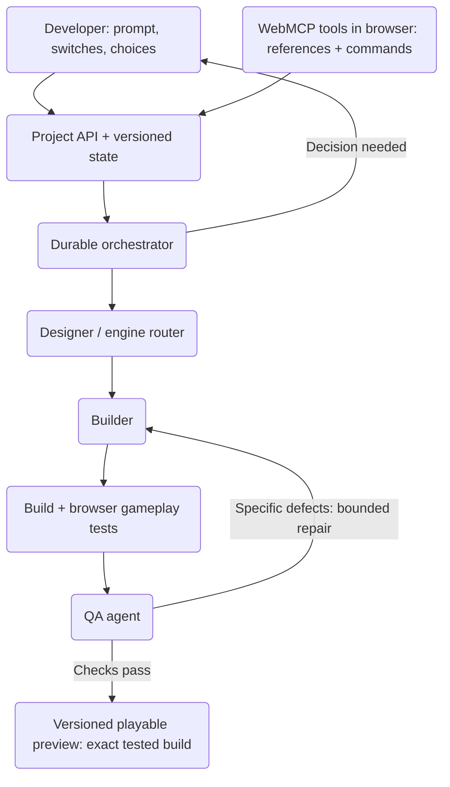
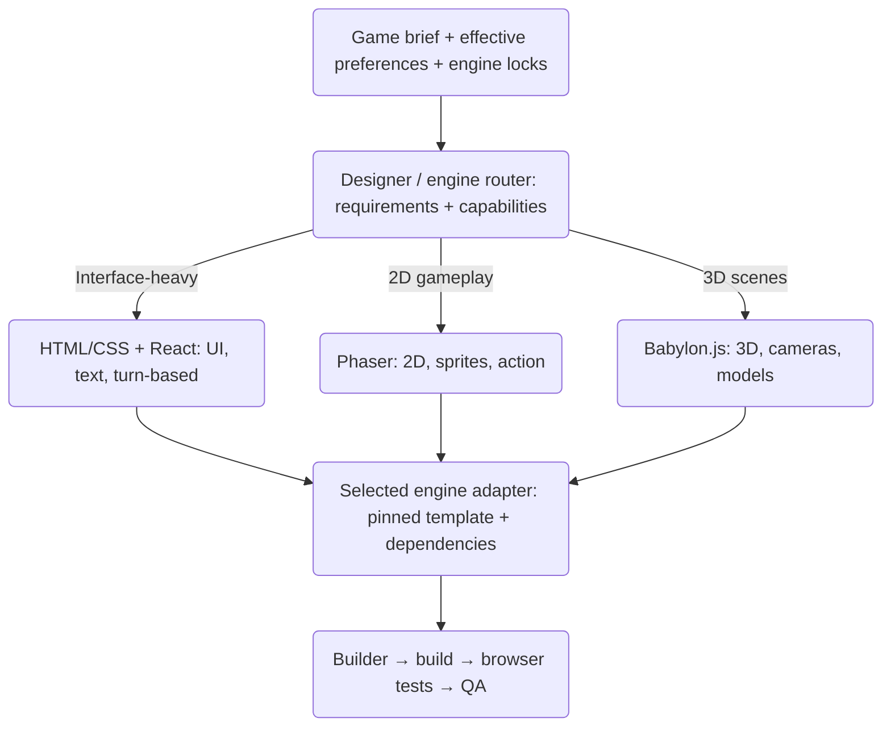
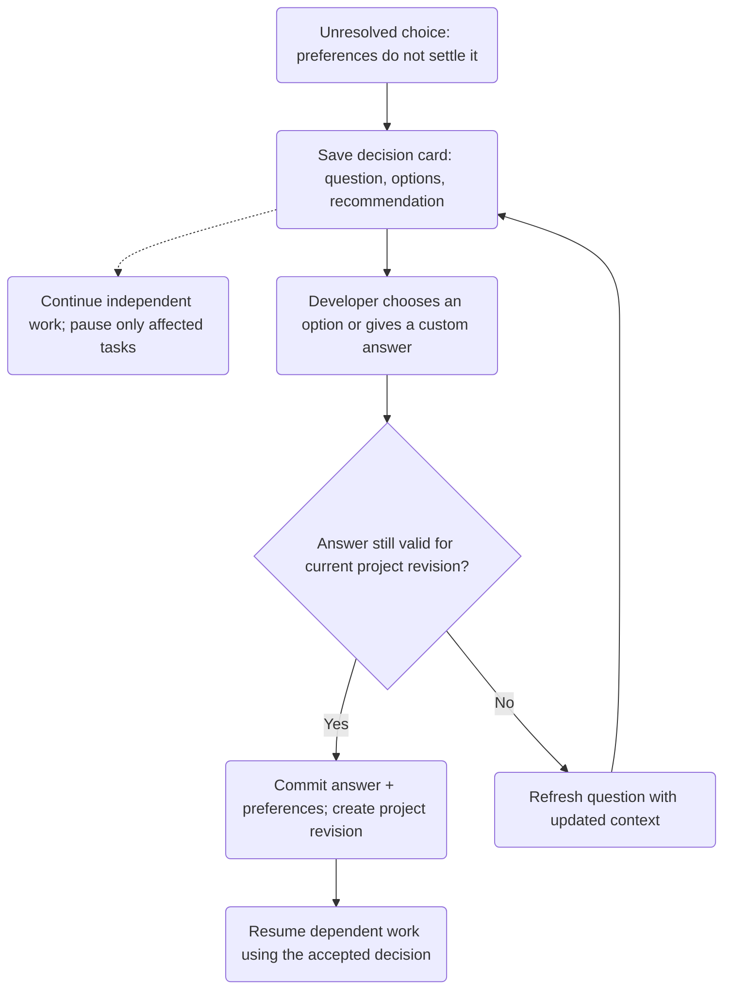

# Web Game Generator — Architecture diagrams

Proposed multi-agent architecture for browser games, including mobile browsers.

## 1. System architecture

Three specialist agents share versioned project state through a durable orchestrator.

[Download SVG](diagrams/system-architecture.svg)

## 2. Engine routing

Route by game requirements and developer preferences; validate explicit engine locks before building.

[Download SVG](diagrams/engine-routing.svg)

## 3. Developer choices during generation

Save each decision, pause only affected tasks, and validate the answer against current project state.

[Download SVG](diagrams/developer-decisions.svg)

---

[Standalone HTML diagrams](web-game-generator-mas-plan.html)
