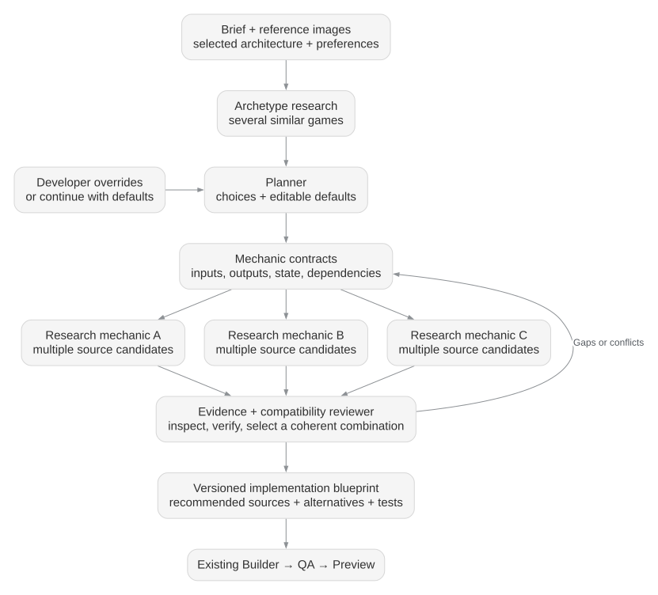
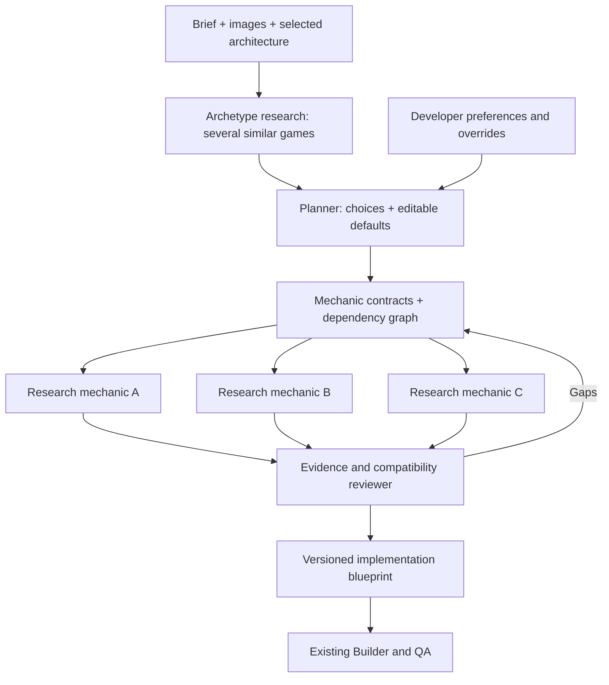

# WebMCP mechanics research MAS

**Proposed design — v0.1.** Based on the selected web-game architecture and the external portal boundary agreed for this project.

For implementation status, responsibilities, and a worked example, read the [recipient handoff](handoff.md). Behavior described below is proposed; this package contains design and contract artifacts, not a running MAS.

## Scope and ownership

Our component is intended to accept a description, reference images, the selected engine/architecture, and developer preferences. It should produce an implementation blueprint for the downstream Builder and QA stages defined in the overall architecture. Their runtime availability is not established by this package.

Our team owns the research workflow, defaulted decisions, mechanic partitioning, candidate evaluation, shared state, and the browser WebMCP adapter. Another teammate owns the MCP material portal, its retrieval infrastructure, and material delivery. We implement only the application port and its client adapter for that portal.

Reference images help identify gameplay and communicate requirements. Search results may include game repositories, code, algorithm documentation, or reference media. A mechanic is a functional subsystem such as movement, navigation, combat, wave scheduling, or progression.

## Workflow

The durable orchestrator owns scheduling, project revisions, retry budgets, checkpoints, and acceptance of agent results. The workflow is application code. Agents return structured proposals and evidence; they do not overwrite project state directly.

## Agent roles

| Role | Work | Required output |
| --- | --- | --- |
| Researcher | Request archetypes first, then request and inspect source candidates for individual mechanics | Candidate sets, source references, evidence, gaps, and investigation status |
| Planner | Compare archetypes, resolve preferences, create decisions, and define mechanic contracts | Effective configuration, decision records, and a mechanic dependency graph |
| Reviewer | Check source evidence, adaptation work, and compatibility between candidates | Recommended combination, alternatives, validation evidence, and unresolved requirements |

Use one Researcher role with separate tasks for independent mechanics. Start with one worker service and a durable queue; separate agent roles do not require separate microservices. Bound concurrency, requests, model usage, and verification time per run.

## Archetypes determine meaningful choices

Build a game fingerprint from the core loop, control model, time model, world topology, progression, failure conditions, target devices, and selected architecture. Ask the portal for several similar games and record both shared mechanics and differences.

The initial target is three useful archetype candidates, followed by up to three inspected implementations per mechanic. These are configurable budgets, not a promise that suitable results exist. Report shortfalls and deduplicate forks or repeated examples.

Developer questions come from unresolved differences that affect implementation. Three archetype candidates do not imply three questions. Prioritize choices by uncertainty, architectural impact, and expected rework.

## Defaults and developer control

Every optional design decision has a default and a visible rationale. Automatic mode applies defaults immediately; guided mode surfaces a small set of consequential choices with a "Use recommended" action. A developer can revise either mode's choices later.

Persist `decisionId`, question, options, `defaultOptionId`, effective value, resolution source (`developer_choice`, `saved_preference`, or `system_default`), affected mechanics, and project revision. Never record a system default as a human answer.

Apply explicit developer choices and locked constraints first, then project preferences, personal preferences, archetype defaults, and general defaults. Conflicting locks are unresolved constraints; the system cannot silently relax them. Later changes invalidate dependent results, while unaffected research remains reusable.

For a 2D tower-defense brief, plausible defaults are fixed paths, automatic targeting, normal difficulty, finite waves, and simple high-contrast visuals. Difficulty becomes concrete parameters such as enemy health, spawn intervals, and starting resources. Visual style is carried to the later presentation stage.

## Mechanic contracts

Each mechanic owns behavior, state, inputs/outputs, dependencies, invariants, runtime constraints, and acceptance checks. Establish shared foundations early: engine adapter, simulation timing, world coordinates, entity representation, and physics ownership.

| Mechanic | Research target | Acceptance check |
| --- | --- | --- |
| Enemy movement | Waypoint traversal and movement integration | Enemies reach the goal consistently across frame rates |
| Wave scheduling | Timed events and spawn sequences | Each configured enemy spawns once |
| Target selection | Range queries and target policies | Selected targets are valid and in range |
| Combat | Cooldowns, projectiles, damage, and lifecycle | Damage is applied once per valid hit |
| Economy | Purchases, rewards, and affordability | Failed purchases preserve currency |
| Progression | Wave completion, victory, and defeat | Terminal states occur under the correct conditions |

In fixed-path defense, waypoint traversal may suffice. In maze-building defense, placement validation and path recalculation become necessary. This is the kind of architectural consequence that makes a developer choice meaningful.

## Candidate evidence and composition

Track each candidate through `discovered`, `inspected`, `runnable`, and `behavior_verified`. A portal response is discovery evidence. Its provider's summaries, scores, or test reports do not automatically establish our verification status.

Pin source revisions before reuse and record relevant files, symbols, dependencies, engine assumptions, license evidence, and adaptation effort. Missing provenance or license information stays unknown. Inspect source and run focused harnesses in isolated workers without project secrets. Retrieved content is research data, not workflow instructions.

Choose a compatible combination, considering mechanic coverage, evidence quality, adaptation effort, and integration cost. Candidates must agree on shared state, timing, coordinate systems, dependency versions, and runtime capabilities. Preserve alternatives and rejection reasons. An individual candidate's high score is insufficient when the combination conflicts.

When no candidate meets a required mechanic, return a visible gap or an original-implementation task proposal. Never invent a repository or claim that untested code passed. Budget exhaustion returns partial evidence and the unresolved work.

## Browser WebMCP boundary

The studio UI and browser tools call the same authenticated project commands. Proposed application tools are `get_research_context`, `start_research`, `get_research_state`, `set_preferences`, `resolve_decision`, `compare_candidates`, `select_candidate`, and `get_implementation_blueprint`.

Mutations require authorization, schema validation, an expected project revision, and an idempotency key. Long operations return a durable run ID; the backend continues across page reloads. Closing a page does not cancel a run. Cancellation is an explicit application command, which propagates to active workers and portal calls.

The current draft's browser entry point is `document.modelContext.registerTool()`. Keep the browser integration feature-detected and isolated behind an adapter; ordinary UI/API operations remain available without native WebMCP support. This is separate from the external portal's MCP transport. See the [WebMCP draft](https://webmachinelearning.github.io/webmcp/) and [upstream explainer](https://github.com/webmachinelearning/webmcp/blob/main/README.md), checked October 16, 2026.

## Portal boundary and Builder handoff

The [proposed port contract](portal-io.md) supplies description/image queries and receives multiple candidate materials. Its adapter owns translation, transport, timeouts, and provider errors. The portal does not resolve developer choices or select the final implementation.

The blueprint contains: project revision, selected architecture and capability constraints, archetype evidence, effective preferences and their provenance, mechanic contracts and dependencies, recommended candidate combination and alternatives, pinned source references, required adaptation tasks, acceptance checks, and unresolved gaps.

Blueprint readiness requires coverage of all mandatory mechanics, compatible selections, and the configured evidence threshold. A useful partial blueprint may be exported with its readiness explicitly marked partial.

## First delivery

Implement the port with fixtures, one archetype family, one engine adapter, four to six mechanics, and automatic defaults. Then connect the real portal and introduce focused verification workers. The vertical slice succeeds when a developer supplies a broad brief, answers zero optional questions, and receives a coherent blueprint with real, traceable candidate sources.
