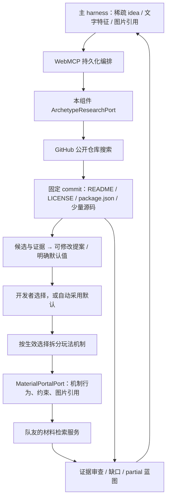

# WebMCP 原型仓库研究：实现范围与交接

开源游戏“大原型”的发现、候选比较依据和源码初探由 **WebMCP 组件负责**。MaterialPortal 是队友负责的机制实现/材料检索服务，暂未接入，不承担本组件的 GitHub 原型查询。主 harness 仍负责项目、生成、QA 与发布。

## 已实现的检索流程

1. 从当前玩法方向生成两个 GitHub 查询：一个 TypeScript 查询（已选 Phaser/Babylon 时附加引擎词），一个较宽的 JavaScript 查询。当前规则覆盖跑酷、生存、解谜、平台跳跃；不是任意自然语言或图片语义搜索。原始 idea 不会原封不动发送给 GitHub。
2. 每个查询取最多 30 条公开仓库结果，按 GitHub 返回顺序去重；相同非空简介只保留一个候选。跳过 fork、归档、私有、没有许可证标识、`NOASSERTION`，以及名称明显属于模板/集合/框架/工具的条目。生存战斗原型会排除描述明确属于社交淘汰和真人秀的游戏。该筛选只是候选预筛，不是法律或相关性认证。
3. 返回最多 3 个搜索元数据候选，只对首选仓库读取源码。先通过 Git ref 固定默认分支 commit，再读取 commit 元数据、根目录和最多一个代码子目录。未完成源码读取的候选保留 `revision: null`、空 `paths` 并标注限制；不会宣称已经验证。
4. 每个仓库最多读取根目录 README、许可证、package.json，以及 3 个关键 JS/TS/HTML 文件。忽略软链接、子模块、vendor、依赖包、构建目录、测试和大文件。读取限制：单文件 96 KB，目录响应 2 MB，单次 HTTP 10 秒，整次原型任务默认 60 秒。
5. 记录仓库 URL、commit、实际读取路径、少量函数/类名、依赖包声明、玩法关键词对应行号与固定链接。源码文本只用于本地静态分析；不会 clone、安装依赖或执行仓库代码。
6. 非模拟候选的文字线索参与提案排序；细节和问题仍来自可解释的规则模板。首次选择后若改变原型、引擎或候选数量，会重新研究选定范围一次，旧发现变成历史。后续修改仍通过 main follow-up 创建新修订。

## 结果如何理解

| 字段 | 含义 |
| --- | --- |
| `provider: github-archetype-research`、`isMock: false` | 已使用真实 GitHub 适配器；不能据此宣称行为验证通过 |
| `candidate.source.revision` | 发现时固定的 commit SHA |
| `candidate.source.paths` | 本次确实读到内容的文件；不是整个仓库已审查 |
| `candidate.evidence` | 搜索链接、读取记录、源码行链接；关键词命中只是线索 |
| `candidate.license` | GitHub 报告的标识与许可证链接；`scope: unknown`，尚未验证素材和源码的具体授权范围 |
| `candidate.limitations` | 文件读取失败、未执行、授权范围等限制 |
| `status: partial` / 蓝图 `evidence: discovered` | 有来源但尚未验证玩法、引擎兼容或组合可运行性 |

失败和不足直接报告；不回退为模拟来源。**默认仅使用本地缓存，缺失缓存时不联网**。token 的存在不会开启联网。搜索、ref、blob/tree 缓存最多 24 小时、200 条，保存在本地 SQLite，重启后仍有效；缓存结果标注获取时间，不保证是当前最新 commit。深度读取中止时保留搜索元数据候选。

## GitHub 请求保护

- 只有服务端显式设置 `WEBMCP_GITHUB_NETWORK=bounded` 才允许联网；当前演示服务保持 `off`。不要为了演示自动开启。
- 每个创意最多 **15 次 HTTP 请求**，失败请求和后续追问共同计数，重启不重置。普通首轮最多 **12 次**：2 次仓库搜索 + 首选仓库最多 10 次读取。只返回搜索元数据的其他候选不会逐个深挖。
- 所有使用同一代码目录的预览实例共享限额：**20 次/分钟、4 次搜索/分钟、30 次/小时、120 次/天**。全局串行，启动间隔至少 2 秒。网络尝试之前原子预留额度；崩溃或取消可能多计一次，绝不返还后盲目补发。
- 任意 401/403/429 都保存至少 5 分钟冷却，并尊重更晚的 `Retry-After` / `x-ratelimit-reset`。无头部的 secondary-limit 403 也会暂停。剩余 core 额度 ≤5 或 search ≤1 时提前暂停；网络错误或 5xx 至少暂停 1 分钟。
- 不自动重试 GitHub job（包括超时、进程中断恢复）。冷却和预算在 `webmcp/.data/github-network.sqlite` 中跨任务、跨进程、跨重启共享；使用独立于运行历史数据库的固定路径，切换 `WEBMCP_DB` 不重置保护。数据库失效时停止查询，不绕过限额。
- 刷新页面和读取状态不会查询 GitHub。界面/API 显示联网开关、当前创意 HTTP 预留次数及共享额度/冷却。
- 这些是本组件的保守限额，不是 GitHub 的无风险承诺。无法控制同一公网 IP 下其他应用、其他机器或另一个 checkout 的请求；多主机部署需共享出口限速服务。不得删除状态库来绕过冷却，也不轮换 IP/账户规避限流。

## 端口与额度

- 上游仍使用 `POST /api/research/runs`、`/decisions`、`/follow-ups` 和读取状态/蓝图接口。新增只读 `GET /api/research/providers` 供 UI 显示当前接入状态。
- 本组件 `src/archetypes.ts` 定义 `ArchetypeResearchPort`；`src/github-archetypes.ts` 实现它。为复用版本与证据校验，沿用 v0.2 的请求/结果类型，`purpose` 必须为 `archetype`；这不代表调用外部材料服务。
- 外部 `MaterialPortalPort` 只接收本运行时的 `purpose: mechanic` 请求。v0.2 wire schema 不变，初始图片引用、选项来源、机制行为与约束仍保留。真实 MCP 工具、鉴权、图像解析由队友适配；`MATERIAL_PORTAL_URL` 的旧 harness 配置不会自动变成 WebMCP 的材料适配器。
- `mainUsed`、`materialUsed` 各最多 3 次；内部 `archetypeUsed` 独立最多 3 次。首轮和首次选择后的单次检索修正不计追问；材料 provider 的重试不计讨论轮次，但计总调用预算；GitHub 不自动重试。旧的 `portalAttempts/maxPortalAttempts` 字段兼容保留，现在表示两类 provider 的总调用次数，不是底层 GitHub HTTP 请求数。旧数据库没有 `archetypeUsed` 时按 0 读取，不改写已有历史计数。
- `/material-follow-ups` 不允许指向原型 job。通过 main follow-up 调整原型研究，避免消耗队友材料额度或绕开边界。

## 本地运行与验证

`pnpm start` 默认使用真实来源适配器的**缓存模式**，材料门户仍未配置。联网需要显式设置 `WEBMCP_GITHUB_NETWORK=bounded`，可选的 `WEBMCP_GITHUB_TOKEN` 只在服务端使用，绝不自动复用其他 GitHub 登录。`WEBMCP_RESEARCH_MODE=fixtures` 显式开启离线模拟；`pnpm demo` 和集成测试显式注入 fixtures。

在 `/research` 输入“猫咪生存游戏，躲避敌群并逐步升级”，开始研究。完成后查看“相似游戏仓库”，展开读取文件与证据；下方选择难度/操作等，或保持默认继续。未接材料服务时，机制卡片显示明确缺口，JSON 可导出，但不能当作可运行游戏或 ready 蓝图。

自动测试覆盖：默认零联网、持久缓存、跨连接互斥、15 次创意预算、小时/日共享预算、重启后冷却、无头部 403、超时不重试、首选仓库固定版本与文件证据、限流/鉴权/空结果、读取大小与取消、候选部分保留、provider 分流、独立额度、初次选项变更后重查、既有生命周期/鉴权/浏览器工具与 harness 透传。真实网络冒烟与这些确定性测试分开，避免 CI 依赖 GitHub 额度。

此前联网版本的历史验证记录（不是本次保护版本的联网测试）：Node 组件 **53 项通过**，Python harness 接入 **10 项通过**，类型检查与格式检查通过。真实 `/research` 输入猫咪生存创意，读取 [giovanneluna/poke-survivors 固定版本](https://github.com/giovanneluna/poke-survivors/tree/188329a4eabe93072d3d18f740e4ce76ed4662da) 的 README、LICENSE、package.json、`src/data/game-settings.ts`、`src/entities/Enemy.ts`、`src/entities/Player.ts`。后续候选读取触发 GitHub 匿名限额，实际保留 **1/3** 候选并显示限流原因；没有将不相关的本地化工具或社交淘汰游戏补进结果。这是一次真实来源冒烟，不是三个候选召回率或游戏可运行性认证。

实现使用 GitHub 官方 [仓库搜索 API](https://docs.github.com/en/rest/search/search)、[Git Trees](https://docs.github.com/en/rest/git/trees)、[Git Blobs](https://docs.github.com/en/rest/git/blobs) 与 [REST 限流语义](https://docs.github.com/en/rest/using-the-rest-api/rate-limits-for-the-rest-api)。

后续能力仍待实现：跨更多游戏类型的语义检索、动态推导问题数量、仓库深层调用关系分析、模型/视觉理解、真实 MaterialPortal 适配，以及隔离环境中的构建和玩法验证。

本次保护版本验证：Node 59 项通过，harness 接入 Python 10 项通过，类型检查通过。GitHub 响应全部注入模拟 fetch；没有为验证保护措施访问真实 GitHub API。完整游戏生成未在本次测试中执行。
