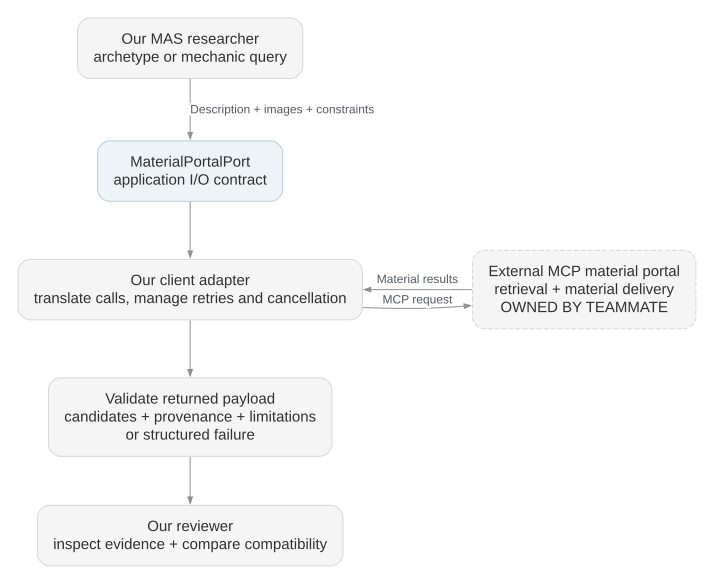
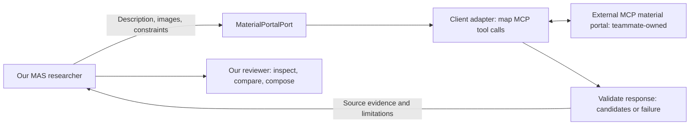

# Proposed material portal I/O contract

**Version 0.2 — proposal for the portal owner.** Tool names, transport, authentication, image resolution, and service limits still need integration agreement. The examples are synthetic fixtures and do not claim real source discoveries.

See the [recipient handoff](handoff.md) for current implementation status, the upstream main-application boundary, and the integration information needed from each team. The behavior below is a proposed contract, not a claim that an adapter or service is running.

## Ownership

| Component | Owner | Responsibility |
| --- | --- | --- |
| MAS and project service | Our team | Archetypes, decisions/defaults, mechanic contracts, candidate review, state, and blueprint |
| Browser WebMCP adapter | Our team | Expose authenticated studio commands to browser agents |
| `MaterialPortalPort` client adapter | Our team | Translate application requests/results to the portal's actual MCP tools |
| External MCP portal | Teammate | Material discovery, retrieval infrastructure, and delivery |

## Request

Use the [TypeScript types](material-portal.ts), [shared discussion types](discussion.ts), and [JSON Schema](material-portal.schema.json) as the proposed application contract. The root schema accepts a portal request, portal result, or main follow-up command; select `#/$defs/MaterialSearchRequest` or `#/$defs/MaterialSearchResult` to validate this specific boundary.

| Field | Meaning |
| --- | --- |
| `contractVersion` | Exact supported contract version, currently `0.2` |
| `requestId` | Stable ID for one logical request; unchanged across retries of identical input |
| `discussion` | Run/thread IDs, round zero or follow-up slot 1–3, parent request ID, and optional follow-up content |
| `projectRevision` | Revision used to formulate the request; stale responses cannot silently replace current work |
| `purpose` | `archetype` or `mechanic` |
| `description` | Self-contained description of the desired game or behavior |
| `images` | Zero or more image references, MIME types, and descriptions |
| `constraints` | Selected engine/version, web platform, language preference, and input modes |
| `materialKinds` | Requested categories of materials |
| `limit` | Maximum number of candidates, integer 1–10 |
| `mechanicId`, `requiredBehavior` | Required for mechanic research; absent for archetype research |

An archetype request asks for similar playable structures and source references. A mechanic request asks for implementations matching a defined functional contract. Candidate material types are `game_repository`, `source_code`, `algorithm_documentation`, and `reference_media`.

Images are inputs to retrieval; responses can contain code and documents. Use portal-accessible URIs or opaque asset references whose resolution both teams agree on. The `asset://` references in examples are placeholders for that agreement. Unsupported images return `UNSUPPORTED_INPUT` or a partial result explaining the limitation; they are never silently ignored. Avoid passing unrelated project data or local machine paths.

## Response

All responses echo `contractVersion`, `requestId`, and the discussion's `runId`, `threadId`, and `round`, and identify `provider`, `retrievedAt`, and `isMock`.

`completed` means the search finished; it does not mean candidates have passed our review. A completed result can contain fewer candidates than requested, including zero. `partial` means some retrieval work could not finish and must include a limitation. Both carry candidates and limitations.

`needs_clarification` carries a `clarificationId`, one or more questions, available candidates, and limitations. Optional questions include choices and a valid default; required questions have no default. The MAS can reply through another `search` call if its material follow-up budget remains. This status is a request for information, not permission to change project constraints.

Each candidate has an ID, type, title, summary, source URI, optional repository and revision, file paths/symbols when available, coverage hints, license evidence or null, supporting references, and limitations. IDs are stable within a provider and request; the MAS deduplicates across runs using source identity. Null or empty metadata remains unknown. Code and asset permissions are not inferred from each other.

The MAS validates result shape, matching request IDs/versions/discussion references, candidate count, requested material types, unique candidate IDs, and clarification/option relationships. It then checks source evidence and architecture compatibility. Provider summaries and evidence references are untrusted material; they cannot override developer locks, authorize commands, or mark a candidate verified.

## Follow-ups: at most three per run on this boundary

Initial searches use round `0`. A refinement or clarification reply carries the full current search specification and a `discussion` context containing `runId`, `threadId`, `round`, `inReplyToRequestId`, and `followUp`. Follow-up content includes a message, the clarification ID when answering questions, and any correlated answers. Results echo only the run/thread/round reference, not the full message.

The orchestrator atomically reserves at most three material follow-up slots across all archetype and mechanic tasks in the run. Main → MAS has its own three-slot allowance. Retries with identical input and request ID reuse the reserved slot; changed requests consume a new one. Neither project revisions nor new thread IDs reset the counters. An initial query for a distinct planned mechanic remains subject to the separate total request/cost budget.

At exhaustion, preserve candidates and return explicit gaps or a partial blueprint; do not open another discussion automatically. The adapter can map full-snapshot follow-ups to a stateless portal. See [discussion-policy.md](discussion-policy.md) for batched questions, defaults, state transitions, command rejection, and migration rules. v0.2 is a breaking proposal update from v0.1.

## Failure, retries, and cancellation

`failed` carries an error code, message, retryability, and optional retry delay. Codes: `UNAVAILABLE`, `TIMEOUT`, `RATE_LIMITED`, `INVALID_INPUT`, `UNSUPPORTED_INPUT`, and `AUTH_REQUIRED`.

Retry only retryable failures within the run's budget, using bounded backoff and the same request ID for identical input. The adapter caches completed requests or uses portal idempotency support where available. A new revision or changed input receives a new request ID. A timeout does not authorize duplicate paid operations; the adapter must reconcile provider jobs when the portal supports them.

The port accepts an optional `AbortSignal`. Explicit cancellation propagates through the adapter; an abort can reject with `AbortError`, and the orchestrator records a cancelled task. Expected provider failures use structured failed results. A browser page unloading does not cancel durable backend work. The application exposes a separate explicit run-cancellation command.

If the portal uses asynchronous jobs, the adapter maps job creation, status, and result retrieval into this application interface. Backend workers persist the provider job ID so recovery can resume an existing request. Browser tools return our durable run ID promptly.

## Development and readiness

Use [the examples](examples/README.md) for a mock adapter first. Their `isMock: true` marker is mandatory. Production blueprint readiness excludes fixture results. The live adapter must not silently fall back to mock candidates when retrieval fails.

Before connecting the portal, agree on actual MCP tool names and schemas, transport endpoint, server-side authentication, image-reference resolution and expiry, source-file access, pagination/result limits, timeouts/rate limits, job recovery, and cancellation support. These are integration details for the teammate-owned service, not implementations included in this package.
